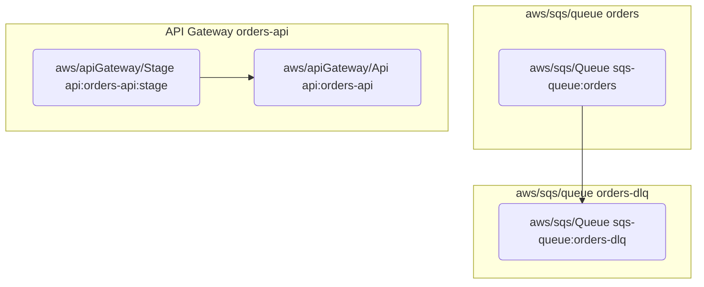

# notation viz

`notation viz` compiles your infrastructure graph for a stage and prints a Mermaid Live Editor URL so you can inspect every resource, resource group, and dependency edge in a browser without deploying or calling cloud APIs.

## Usage

Run `notation viz` from your project root or via the `viz` script in starter projects:

::code-group

```sh [CLI]
notation viz
```

```sh [Package script]
@pm.run("viz")
```

::

Pass `--config` and `--stage` to visualize a non-default config or stage:

```sh [Terminal]
notation viz --config apps/orders/notation.config.ts --stage prod
```

`notation viz` prints the evaluated entrypoint followed by the Mermaid Live Editor URL:

```text [Terminal]
Generating graph for /path/to/project/infra/orders.ts

Generated infrastructure chart:

https://mermaid.live/view#pako:eN...
```

`notation viz` prints only the URL – it does not write raw Mermaid text to `stdout` or open a browser automatically.

## Options

`notation viz` accepts `--config <path>` and `--stage <stage>`. It resolves `{ app, stage }` so [`deployment()`](../core/project-config.md) returns the active stage, and exits with an error if neither `--stage` nor `defaultStage` is set.

## Diagram output

`notation viz` renders a top-down Mermaid flowchart (`flowchart TD`) and encodes it into a `https://mermaid.live/view#pako:...` URL:

- **Subgraphs** – Each [resource group](../core/resources.md) becomes a Mermaid `subgraph`, while ungrouped resources appear at the top level.
- **Dependency edges** – Arrows (`A --> B`) point from each dependent resource to its dependencies.

## Example

Consider an orders stack connecting a dead-letter queue, an orders queue, an HTTP API, and a route handler:

```ts [infra/orders.ts]
import { queue } from "@notation/aws/sqs";
import { api, router } from "@notation/aws/api-gateway";
import { DeadLetter, Order } from "../shared/schema";
import { lambda as createOrder } from "../runtime/create-order";

export const orderDlq = queue({ id: "orders-dlq", schema: DeadLetter });

export const orderQueue = queue({
  id: "orders",
  schema: Order,
  deadLetterQueue: { queue: orderDlq, maxReceiveCount: 3 },
});

const ordersApi = api({ id: "orders-api" });
router(ordersApi).post("/orders", () => createOrder);
```

When rendered to Mermaid, each construct group becomes a subgraph with directed edges showing dependency flow:



## Graph evaluation

`notation viz` performs the minimum work required to materialize the resource graph:

| Step | Behavior |
| :--- | :--- |
| Infrastructure build | Compiles the infrastructure bundle without building runtime handlers |
| Declaration checks | Skips declaration validation so unfinished handlers do not block diagrams |
| State and provider calls | Skips state access, drift detection, and cloud API calls |

## Programmatic graph generation

To emit raw Mermaid text (for example, to save `.mmd` files in CI), compile first with [`notation compile`](./compile.md) and call `@notation/core` helpers:

```ts [scripts/graph.ts]
import { createMermaidFlowChart, getResourceGraph, loadProject, resolveDeployment } from "@notation/core";

const project = await loadProject();
const { entryPoint, app, stage } = resolveDeployment(project, { stage: "dev" });
const graph = await getResourceGraph(entryPoint, { app, stage }, { declarationChecks: false });

console.log(createMermaidFlowChart(graph.resourceGroups, graph.resources));
```
