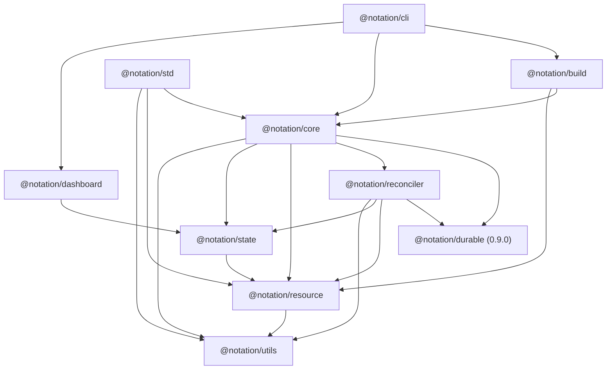

# Architecture

Notation separates authoring, compilation, planning, and durable state execution across focused workspace packages backed by `@notation/durable`. Package boundaries and singleton invariants keep deploy-time and runtime artifacts isolated without cross-copy corruption.

## Package dependency graph

Dependencies flow upward from shared utilities and resource primitives through compilation, reconciliation, orchestration, and CLI tooling:



### Workspace packages

Packages layer upward from shared primitives to execution, compilation, and tooling:

| Package | Purpose |
| :--- | :--- |
| `@notation/utils` | Secret scrubbing and low-level helpers with no workspace dependencies |
| `@notation/resource` | Resource primitives, graph collection, refs, derived values, and naming |
| `@notation/state` | `StateNode` schema, `StateBackend` interface, and concurrency conflict types |
| `@notation/durable` | External durable workflow engine and SQLite execution runtime |
| `@notation/reconciler` | Graph ordering, planning, credential resolution, and durable workflows |
| `@notation/core` | Config loading, graph orchestration, `NodeDurableRuntime`, and provisioner workflows |
| `@notation/build` | JSDoc marks, AST analysis, module classification, Rolldown plugins, and `Bundle` |
| `@notation/std` | Standard file/zip resources, credential sources, and change tracking |
| `@notation/dashboard` | Fastify and React UI streaming `StateBackend.values()` over SSE |
| `@notation/cli` | `notation` CLI binary built on Commander, Rolldown, and Chokidar |

`@notation/durable` is pinned at `0.9.0` and used by `@notation/reconciler` and `@notation/core`. `@notation/reconciler` implements `createPlan` (see [Planner](./planner.md)) and exports `@notation/reconciler/durable` workflow generators (`durable.deploy`, `durable.destroy`). Provider packages (`@notation/aws`, `@notation/cloudflare`, `@notation/infisical`) sit above `@notation/resource` and `@notation/std`, with `@notation/aws` and `@notation/cloudflare` also depending on `@notation/core` and `@notation/build`.

## Compile-to-reconcile data flow

Every `plan`, `deploy`, and `destroy` invocation transforms source modules on disk, evaluates the compiled graph in Node, and reconciles against SQLite-backed durable state.

### Compilation

`compile({ entryPoint, files })` in `@notation/cli` (`packages/cli/src/compile.ts`) shares one `ModuleAnalyses` instance across two Rolldown passes:

1. **Infra pass (`compileInfra`)** – Bundles `infraEntry` (`"notation:infra-entry"`) with `infraEntryPlugin` and `infraPlugin` (`platform: "node"`, `sourcemap: true`) into `dist/`. Strips non-declaration runtime code and emits a sorted `DeclarationModule[]` list.
2. **Runtime pass (`compileRuntimeModules`)** – Filters `DeclarationModule` entries that define `entry`. Bundles each with `functionBuildOptions(module.platform)` and `runtimePlugin` into a single-file ESM artifact at `dist/<module path>/index.mjs`.

### Graph collection

`planApp`, `deployApp`, and `destroyApp` in `@notation/core` call `getResourceGraph(entryPoint, scope, opts)` (`packages/core/src/orchestrator/graph.ts`):

```ts [packages/core/src/orchestrator/graph.ts]
return collectResourceGraph(
  async () => {
    await import(`${outFilePath}?${Date.now()}`);
  },
  { scope, declarationChecks: opts.declarationChecks },
);
```

Importing the compiled infra bundle with a cache-busting timestamp executes top-level `new` resource and `ResourceGroup` constructors against the active `ResourceCollection` in `@notation/resource`:

1. **Synchronous module evaluation** – Resources register into `collection.graph`. Wiring helpers such as `$lambda` and `$worker` register callbacks via `onEvaluationEnd`.
2. **End-of-evaluation queue** – Once `evaluate()` resolves, `collectResourceGraph` sets `collection.evaluationEnded = true` and drains `collection.endOfEvaluation` FIFO. Callbacks added during draining run at the tail.
3. **Validation drain** – `collectResourceGraph` awaits `Promise.all(collection.pendingValidations)` and sets `collection.closed = true`. Further contributions are blocked, and `{ resourceGroups, resources }` is returned.

`destroyApp` passes `{ declarationChecks: false }` so config validation issues on live declarations do not block teardown.

### Provider loading

`NodeDurableRuntime` (`packages/core/src/provisioner/durable-runtime.ts`) opens SQLite (`NOTATION_DATABASE_PATH` or `filePaths.database()`) with `createSqliteDb` and `SqliteRuntime`. It exposes a `DurableStateBackend` scoped to `deploymentId` (`<app>--<stage>`).

Before planning or reconciling, `loadPlanProviderRegistry` and `loadStateProviderRegistry` (`packages/core/src/provisioner/resource-registry.ts`) compare `StateNode` records against `graph.resources`. When an orphan or retired record's `type` is absent from code, the provisioner dynamically imports `<node.provider>/resources` to recover its `ResourceClass` for deletion.

### Durable reconciliation

Planning runs `createPlan` directly inside `withRuntime`. In contrast, `deployApp` and `destroyApp` execute `durable.deploy` or `durable.destroy` through `runDurableWorkflow`:

1. **Admission** – `NodeDurableRuntime.run` admits `opts.executionId` before starting `ExecutionDispatcher` (filtered strictly to `[opts.executionId]`). Resumed runs verify `assertSameOverrides`.
2. **Pre-hold validation (`notation:validate`)** – `durable.deploy` checks `--replace` and `--credential` hashes. It validates statically known params before acquiring any lock.
3. **Deployment hold (`withDeploymentHold`)** – Acquires the per-deployment lock and re-checks overrides (`notation:overrides`). Snapshots recorded outputs (`notation:recorded-outputs`) so `StateRef` lookups see a consistent baseline, then calls each source class's `prefetch` outside any step.
4. **Topological reconciliation** – `orderDeployUnits(resources)` orders strongly connected components and dependency edges. Each unit runs `reconcileResource` or `reconcileCycle`, followed by `sweepOrphans`.

## Single-copy invariants

Node monorepos and nested `node_modules` trees can accidentally install multiple copies of a package in one process, which breaks module-scoped registries unless guarded.

### Resource collection singleton

`collectResourceGraph` relies on a module-level `activeCollection` variable in `packages/resource/src/resource-collection.ts`. If a second copy of `@notation/resource` loaded, resources created through it would read `undefined` from their own `activeCollection` and vanish from the graph.

To fail immediately at import time, `resource-collection.ts` registers its module URL under `Symbol.for("@notation/resource/loaded")` on `globalThis`:

```ts [packages/resource/src/resource-collection.ts]
const loadedKey = Symbol.for("@notation/resource/loaded");

export function claimSingleCopy(url: string) {
  const registry = globalThis as { [loadedKey]?: string };
  const loaded = registry[loadedKey];
  if (loaded === undefined) registry[loadedKey] = url;
  else if (loaded !== url) {
    throw new Error(
      `Two versions of @notation/resource were detected at ${loaded} and ${url}. Please install one version (for example with npm dedupe).`,
    );
  }
}

claimSingleCopy((import.meta as ImportMeta & { url: string }).url);
```

Re-running `claimSingleCopy` with the identical `url` is a no-op; any distinct module URL throws immediately.

### Cross-copy symbol brands

Other packages tolerate multiple installed copies by storing state or identity brands under `Symbol.for(...)` keys rather than private symbols or `instanceof` checks:

| Key | Purpose |
| :--- | :--- |
| `Symbol.for("@notation/declaredIn")` | Attaches module provenance via `__notation_declaredIn` for `getDeclaredIn` |
| `Symbol.for("@notation/resource/OutputRef")` | Brands `OutputRef`, `CredentialRef`, and `StateRef` instances across copies |
| `Symbol.for("@notation/resource/Derived")` | Brands `Derived` computations created by `text`, `map`, and `all` |
| `Symbol.for("@notation/utils/secret-values")` | Shares the process-wide secret-scrubbing set on `globalThis` |

For per-collection provider state, `perCollection(key, create)` keys `activeCollection.stores` by string such as `"@notation/cloudflare/workers"`. Separate copies of a provider package share one store during graph evaluation.

### Structural type checks

Resource identification across package boundaries avoids `instanceof` on classes from separate package copies. `isBundle()` in `@notation/build/resources` checks `value?.type === "build/bundle/Bundle"` against `BundleLike`. This lets `lambda()` and `worker()` accept `Bundle` instances produced by another copy of `@notation/build`.
